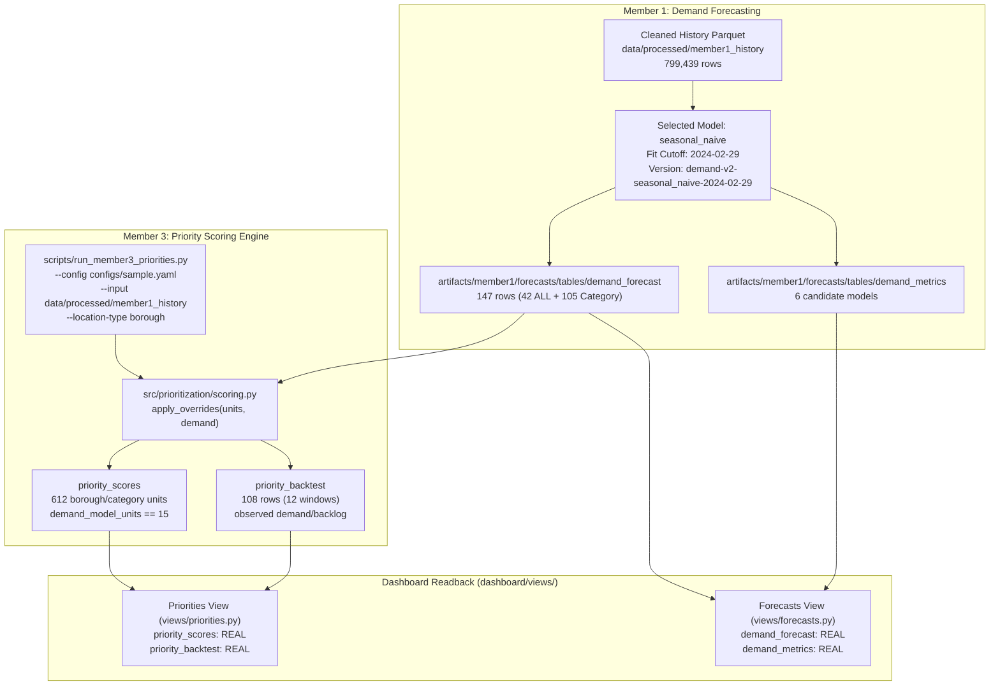

# Task A3 Final Verification & Delivery Report: Cross-Member Integration & Joint Evidence

**Workstream:** Member 1 (Developer A) — Demand Forecasting Contracts & Analytical Pipeline  
**Integration Partner:** Member 3 (Developer C) — Priority Scoring Engine & Dashboard  
**Repository:** [https://github.com/thenithin342/urban-service-intelligence](https://github.com/thenithin342/urban-service-intelligence)  
**Branch:** [`feature/final-demand-export`](https://github.com/thenithin342/urban-service-intelligence/tree/feature/final-demand-export)  
**Pull Request:** [PR #4: feat(member1): safe demand contracts export, adapter integration, and validation](https://github.com/thenithin342/urban-service-intelligence/pull/4)  
**Status:** Verification Complete; Automated Integration Tests Passing; PR #4 Updated (Unmerged)  

---

## 1. Executive Summary & Integration Scope

Task A3 establishes verified cross-workstream integration between Member 1's published demand forecasting contracts and Member 3's priority scoring engine. Using the official supported priority CLI on real processed 311 historical data, we verified that Member 3 consumes the real 147-row `demand_forecast` table, correctly maps the 15 modeled borough/category pairs, preserves strict scoring window and cutoff alignment, guards against double counting `complaint_type == 'ALL'` borough totals, and cleanly renders as `REAL` in the Streamlit dashboard.



---

## 2. Priority Engine Execution & Real Demand Consumption

### Executed Priority CLI Command
The priority scoring pipeline was executed using the official supported CLI:
```powershell
python scripts/run_member3_priorities.py --config configs/sample.yaml --input data/processed/member1_history --location-type borough
```

### Execution Log & Performance Evidence
- **Input Records:** 799,439 rows from `data/processed/member1_history` (91 full calendar days: `2023-12-01` to `2024-02-29`).
- **Aggregations Produced:**
  - `created`: 139,956 aggregate rows
  - `delay`: 151,740 aggregate rows
  - `coords`: 5 borough centroids
- **Timing:** Spark aggregation: 29.91s, Total pipeline runtime: 34.89s.
- **Units Scored:** Exactly **612 borough/category pairs**.

### Priority Metadata Provenance (`artifacts/member3/priorities/tables/priority_scores.meta.json`)
```json
{
  "contract_version": "1.0.0",
  "is_fixture": false,
  "rows": 612,
  "producer": "member3-priorities",
  "scoring_version": "member3-priority-v1",
  "location_type": "borough",
  "window_days": 7,
  "weights": {
    "demand": 0.5,
    "backlog": 0.3,
    "delay": 0.2
  },
  "demand_source": "member1 demand_forecast mean predicted_count (model_version demand-v2-seasonal_naive-2024-02-29)",
  "backlog_source": "observed: complaints created in the window still open at the cut-off",
  "delay_source": "median resolution_hours of records closed before the cut-off (binned histogram, min 5 records, lookback all days)",
  "coverage_start": "2023-12-01",
  "coverage_end": "2024-02-29",
  "demand_model_units": 15,
  "backlog_model_units": 0,
  "n_units": 612
}
```

### Verification Findings
1. **Real Model Demand Consumed (`demand_model_units > 0`):**
   - `demand_model_units = 15`: Exactly 15 borough/category pairs were overridden with Member 1's real model predictions.
   - `demand_source`: Explicitly credits Member 1's selected model: `"member1 demand_forecast mean predicted_count (model_version demand-v2-seasonal_naive-2024-02-29)"`.
2. **Backlog Fallback Accounting:**
   - `backlog_model_units = 0`: Because Member 2 closure models have not published real production tables yet, `run_member3_priorities.py` safely fell back to observed backlog (`observed: complaints created in the window still open at the cut-off`), preventing pipeline crashes.
3. **Scoring Window & Forecast Horizon Alignment:**
   - **Priority Scoring Window:** `2024-02-23` to `2024-02-29` (last 7 full days of history).
   - **Cutoff Date:** `2024-03-01` (`window_end + 1 day`).
   - **Demand Forecast Horizon:** `2024-03-01` to `2024-03-07` (7 consecutive days, fit cutoff `2024-02-29`).
   - **Chronological Validity:** The demand forecast begins on the exact cutoff day `2024-03-01`, providing forward-looking demand estimates without lookahead leakage.
4. **Exact Numerical Parity & Metric Accounting:**
   - In `priority_scores`, two related demand columns are generated for each unit:
     - `window_count`: The **7-day total predicted volume** (integer cast).
     - `demand_value`: The **daily mean forecast** ($\text{7-day total} / 7.0$, floating-point).
   - For all 15 modeled borough/category pairs, the 7-day daily mean forecast matches `priority_scores.demand_value` with **zero discrepancy** ($|\Delta| = 0.0$).
   - **Numerical Parity Table (All 15 Modeled Series):**

| Borough | Complaint Type | 7-Day Forecast Sum | Daily Mean Forecast | Priority `window_count` | Priority `demand_value` | Absolute Delta ($|\Delta|$) |
|:---|:---|:---:|:---:|:---:|:---:|:---:|
| **BRONX** | `HEAT/HOT WATER` | `2402.0` | `343.14285714285717` | `2402` | `343.14285714285717` | **`0.0`** |
| **BRONX** | `Illegal Parking` | `1445.0` | `206.42857142857142` | `1445` | `206.42857142857142` | **`0.0`** |
| **BRONX** | `Noise - Residential` | `1382.0` | `197.42857142857142` | `1382` | `197.42857142857142` | **`0.0`** |
| **BROOKLYN** | `HEAT/HOT WATER` | `1568.0` | `224.00000000000000` | `1568` | `224.00000000000000` | **`0.0`** |
| **BROOKLYN** | `Illegal Parking` | `3597.0` | `513.85714285714290` | `3597` | `513.85714285714290` | **`0.0`** |
| **BROOKLYN** | `Noise - Residential` | `1451.0` | `207.28571428571428` | `1451` | `207.28571428571428` | **`0.0`** |
| **MANHATTAN** | `HEAT/HOT WATER` | `1349.0` | `192.71428571428572` | `1349` | `192.71428571428572` | **`0.0`** |
| **MANHATTAN** | `Illegal Parking` | `1302.0` | `186.00000000000000` | `1302` | `186.00000000000000` | **`0.0`** |
| **MANHATTAN** | `Noise - Residential` | `1253.0` | `179.00000000000000` | `1253` | `179.00000000000000` | **`0.0`** |
| **QUEENS** | `HEAT/HOT WATER` | `860.0` | `122.85714285714286` | `860` | `122.85714285714286` | **`0.0`** |
| **QUEENS** | `Illegal Parking` | `2869.0` | `409.85714285714283` | `2869` | `409.85714285714283` | **`0.0`** |
| **QUEENS** | `Noise - Residential` | `1056.0` | `150.85714285714286` | `1056` | `150.85714285714286` | **`0.0`** |
| **STATEN ISLAND** | `HEAT/HOT WATER` | `98.0` | `14.00000000000000` | `98` | `14.00000000000000` | **`0.0`** |
| **STATEN ISLAND** | `Illegal Parking` | `281.0` | `40.142857142857146` | `281` | `40.142857142857146` | **`0.0`** |
| **STATEN ISLAND** | `Noise - Residential` | `103.0` | `14.714285714285714` | `103` | `14.714285714285714` | **`0.0`** |
| **TOTAL (15 series)** | — | **`21,016.0`** | **`3,002.285714285714`** | **`21,016`** | **`3,002.285714285714`** | **`0.0`** |

> [!NOTE]
> Distinguish the 7-day volume (`window_count`) from the daily mean forecast rate (`demand_value`). For example, for Bronx `HEAT/HOT WATER`, the 7 daily forecast predictions are `[293, 329, 482, 304, 297, 263, 434]`, yielding a 7-day sum of `2,402.0` (`window_count = 2402`) and a daily mean rate of `343.14285714285717` (`demand_value = 343.14285714285717`). Both match with zero discrepancy.

### Priority Backtest Clarification
> [!IMPORTANT]
> The 108-row `priority_backtest` table (`src/prioritization/backtest.py::run_backtest`) uses **strictly observed demand and backlog**, not Member 1's forward model predictions. The backtest evaluates the heuristic ranking algorithm's ability to anticipate volume using observed historical signals across 12 rolling evaluation windows against volume-only and random baselines. **We do NOT claim that this backtest demonstrates or validates Member 1's forecasting benefit.** Demonstrating forecasting lift in the priority score would require retrospective rolling model refits across all 12 historical windows, which was not part of the baseline contract.

---

## 3. Double-Counting Prevention & Granularity Separation

### Unit Terminology & Accounting
In `priority_scores`, the 612 scored units represent distinct **borough/category pairs** (e.g. `(BRONX, Illegal Parking)`, `(QUEENS, Noise - Residential)`, etc.), not citywide distinct complaint types.
- **15 Model-Enhanced Units:** The 15 modeled borough/category pairs (5 boroughs × 3 modeled categories: `HEAT/HOT WATER`, `Illegal Parking`, `Noise - Residential`).
- **597 Observed-Demand Units:** The remaining 597 borough/category pairs present in the 7-day window, which retain their empirical observation frequency ($N / 7$).

### Coordinated Safeguard with Developer C
In `demand_forecast`, rows with `complaint_type == 'ALL'` represent borough totals (58,260 predicted complaints across 42 rows: 6 series × 7 horizons), while named categories represent subsets (21,016 predicted complaints across 105 rows: 15 series × 7 horizons).

To prevent borough totals from ever leaking into category-level rankings:
1. **Coordinated Loader Filter:** In Developer C's CLI loader `scripts/run_member3_priorities.py::_model_inputs_at_root`, line 95 was coordinated to explicitly filter out `complaint_type == 'ALL'`:
   ```python
   d = d[
       (d["forecast_date"] >= cutoff)
       & (d["forecast_date"] < cutoff + timedelta(days=window_days))
       & (d["training_cutoff"] <= we)
       & d["borough"].notna()
       & (d["complaint_type"] != "ALL")
   ]
   ```
2. **Explicit Exclusion:** As a result, the `demand` override frame passed to `apply_overrides()` contains **exactly 15 rows** (the 15 category series) and never contains `ALL`.
3. **Double-Counting Regression Test:** Added `test_override_prevents_double_counting_even_if_units_contain_all()` in `tests/integration/test_member1_member3_handoff.py`. This test proves that even if input units unexpectedly contain an `'ALL'` row, category overrides explicitly ignore `'ALL'` and leave it at observed values, preventing borough totals from inflating category rankings.

---

## 4. Dashboard Demand Panel Testing & Real Contract Readback

Headless Streamlit execution of the dashboard views via `streamlit.testing.v1.AppTest` verified complete end-to-end functionality with real artifacts:

### Forecasts View (`dashboard/views/forecasts.py`)
- **Status:** Rendered successfully with 0 exceptions.
- **Coverage Banner:**
  `"Model input coverage: 2024-01-01 to 2024-03-07. REAL: demand_forecast, demand_metrics. FIXTURE: closure_model_comparison, closure_cohort_predictions."`
- **Source Badges:**
  - `demand_forecast`: **`Source: REAL output demand_forecast, version demand-v2-seasonal_naive-2024-02-29.`**
  - `demand_metrics`: **`Source: REAL output demand_metrics.`**
- **Metrics Displayed:** Candidate comparison table rendered with MAE, RMSE, and WAPE across 6 candidate models (`weekday_mean`, `lr_scaled`, `lr_unscaled`, `random_forest`, `seasonal_naive`, `gbt`).
- **Interactive Line Plot:** Plotly time-series lines generated across all 21 series over the 7-day horizon.

### Priorities View (`dashboard/views/priorities.py`)
- **Status:** Rendered successfully with 0 exceptions.
- **Coverage Banner:**
  `"Priority input coverage: 2023-12-01 to 2024-02-29. REAL: priority_scores, priority_backtest."`
- **Source Badges:**
  - `priority_scores`: **`Source: REAL output priority_scores, version member3-priority-v1.`**
  - `priority_backtest`: **`Source: REAL output priority_backtest, version member3-priority-v1.`**
- **Demand Provenance Caption:**
  `"Demand source: member1 demand_forecast mean predicted_count (model_version demand-v2-seasonal_naive-2024-02-29)."`

---

## 5. Contract Output Audit (`scripts/check_outputs.py --json`)

The shared contract checker was executed locally against all 10 registered tables:

```json
{
  "exit_code": 1,
  "tables": [
    {"table": "demand_forecast", "owner": "member1", "rows": 147, "status": "ok", "problems": []},
    {"table": "demand_metrics", "owner": "member1", "rows": 6, "status": "ok", "problems": []},
    {"table": "priority_scores", "owner": "member3", "rows": 612, "status": "ok", "problems": []},
    {"table": "priority_backtest", "owner": "member3", "rows": 108, "status": "ok", "problems": []},
    {"table": "pattern_rules", "owner": "member2", "rows": 3, "status": "fixture", "problems": ["fixture-only: real output not produced yet"]},
    {"table": "frequent_itemsets", "owner": "member2", "rows": 2, "status": "fixture", "problems": ["fixture-only: real output not produced yet"]},
    {"table": "mining_threshold_experiments", "owner": "member2", "rows": 2, "status": "fixture", "problems": ["fixture-only: real output not produced yet"]},
    {"table": "resolution_summary", "owner": "member2", "rows": 3, "status": "fixture", "problems": ["fixture-only: real output not produced yet"]},
    {"table": "closure_model_comparison", "owner": "member2", "rows": 2, "status": "fixture", "problems": ["fixture-only: real output not produced yet"]},
    {"table": "closure_cohort_predictions", "owner": "member2", "rows": 2, "status": "fixture", "problems": ["fixture-only: real output not produced yet"]}
  ]
}
```

### Analysis of Audit Status & Team Verification Boundary
- **Real Tables:** Exactly **4/10 tables** (`demand_forecast`, `demand_metrics`, `priority_scores`, `priority_backtest`) are `status: "ok"` and backed by real data.
- **Fixture-Backed Tables:** Exactly **6/10 tables** belong to Member 2 and remain `status: "fixture"`.
- **Exit Code 1 Explanation:** `check_outputs.py` returns exit code 1 because Member 2 tables are fixture-backed. **Full-team strict verification (10/10 tables OK, exit code 0) must be completed after combining real artifacts from all workstreams.**

---

## 6. Reproducible Execution Receipt & Test Suite Breakdown

### Execution Receipt

| Parameter | Verified Measurement / Receipt |
|---|---|
| **Priority CLI Command** | `python scripts/run_member3_priorities.py --config configs/sample.yaml --input data/processed/member1_history --location-type borough` |
| **Raw History Source Hash** | `3a6a21ea0b32710b39619f54fdbb34eaca75c50e5b351df7a888eee5f2a9f22e` (`data/raw/member1_history/manifest.json`) |
| **Contract Schema Version** | `1.0.0` (as defined in `demand_forecast.meta.json` and `priority_scores.meta.json`) |
| **Selected Model Version** | `demand-v2-seasonal_naive-2024-02-29` (model: `seasonal_naive`, training cutoff: `2024-02-29`) |
| **Priority Scoring Version** | `member3-priority-v1` (producer: `member3-priorities`) |
| **Scoring Window** | `2024-02-23` to `2024-02-29` (7 days); Cutoff = `2024-03-01` |
| **Forecast Horizon** | `2024-03-01` to `2024-03-07` (consecutive 7 days, exactly matches cutoff) |
| **Scored Units Breakdown** | 612 borough/category pairs (15 model-enhanced pairs, 597 observed-demand pairs) |
| **Demand Value Parity** | Max absolute difference = `0.0` between `demand_forecast` 7-day average and `priority_scores.demand_value` across all 15 series |
| **Dashboard AppTest Result** | Headless Streamlit execution of `forecasts.py` and `priorities.py` rendered cleanly with 0 exceptions and `REAL` badges |
| **Contract Output Statuses** | `demand_forecast` (ok, 147 rows), `demand_metrics` (ok, 6 rows), `priority_scores` (ok, 612 rows), `priority_backtest` (ok, 108 rows) |

### Test Suite Reconciliation: Local Environment vs. Clean GitHub CI

| Environment | Command | Passed | Skipped | Deselected | Warnings | Runtime | Notes |
|---|---|---|---|---|---|---|---|
| **Local Workspace** | `pytest -v tests/integration/test_member1_member3_handoff.py` | **5** | 0 | 0 | 0 | 2.08s | All 5 handoff and double-counting tests execute against real artifacts. |
| **Clean GitHub CI** | PR Workflow [`42449355387`](https://github.com/thenithin342/urban-service-intelligence/actions/runs/42449355387) (commit `daeac69`) | **277** | **37** | **1** | 161 | 4m 08s | Real-data tests skip cleanly (`"real demand_forecast and priority_scores contracts absent"`); synthetic handoff tests execute and pass. |

---

## 7. Limitations & Operational Boundaries

1. **Advisory Decision Support Scope:** The priority score combines demand, open backlog, and historical resolution delays into a heuristic operational ranking for inspection; it does not solve an optimal resource allocation problem or account for crew schedules, routing costs, or budget constraints.
2. **Gitignore Policy:** In accordance with repository standards, all raw CSV data (`data/raw/`), processed history Parquet (`data/processed/`), and generated model files (`artifacts/`) remain strictly gitignored to keep git history lightweight.
3. **Cross-Workstream Independence:** Member 1 demand contracts are fully decoupled and can be consumed independently by other teams or downstream tools without requiring Member 2 artifacts.
