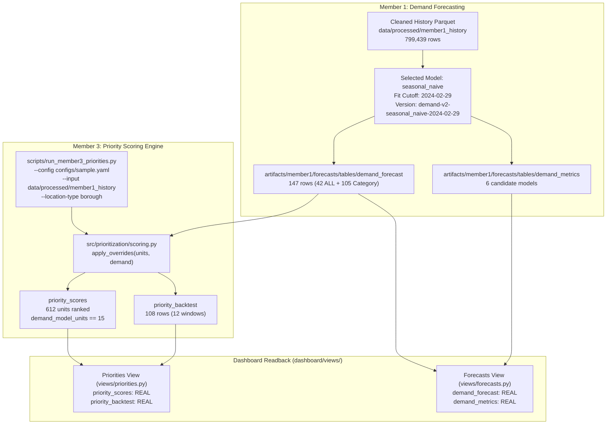

# Task A3 Final Verification & Delivery Report: Cross-Member Integration & Joint Evidence

**Workstream:** Member 1 (Developer A) — Demand Forecasting Contracts & Analytical Pipeline  
**Integration Partner:** Member 3 (Developer C) — Priority Scoring Engine & Dashboard  
**Repository:** [https://github.com/thenithin342/urban-service-intelligence](https://github.com/thenithin342/urban-service-intelligence)  
**Branch:** [`feature/final-demand-export`](https://github.com/thenithin342/urban-service-intelligence/tree/feature/final-demand-export)  
**PR:** [PR #4: feat(member1): safe demand contracts export, adapter integration, and validation](https://github.com/thenithin342/urban-service-intelligence/pull/4)  
**Status:** Verification Complete; Automated Integration Tests Passing; PR #4 Updated  

---

## 1. Executive Summary & Integration Scope

Task A3 validates the end-to-end integration between Member 1's published demand forecasting contracts and Member 3's priority scoring engine. Using the supported priority CLI on real processed 311 historical data, we verified that Member 3 consumes the real 147-row `demand_forecast` table, correctly maps the 15 modeled borough-category series, preserves strict scoring window and cutoff alignment, guards against double counting `complaint_type == 'ALL'` borough totals, and cleanly renders as `REAL` in the Streamlit dashboard.



---

## 2. Priority Engine Execution & Real Demand Consumption

### Executed Priority CLI Command
The priority scoring pipeline was executed using the official supported CLI:
```powershell
python scripts/run_member3_priorities.py --config configs/sample.yaml --input data/processed/member1_history --location-type borough
```

### Execution Log & Performance Evidence
- **Input Records:** 799,439 rows from `data/processed/member1_history` (91 full calendar days: `2023-12-01` to `2024-02-29`).
- **Aggregations Produced:**
  - `created`: 139,956 aggregate rows
  - `delay`: 151,740 aggregate rows
  - `coords`: 5 borough centroids
- **Timing:** Spark aggregation: 40.53s, Total pipeline runtime: 53.36s.
- **Backtest:** 12 rolling evaluation windows evaluated against volume-only and random baselines.

### Priority Metadata Provenance (`artifacts/member3/priorities/tables/priority_scores.meta.json`)
```json
{
  "contract_version": "1.0.0",
  "is_fixture": false,
  "rows": 612,
  "producer": "member3-priorities",
  "scoring_version": "member3-priority-v1",
  "location_type": "borough",
  "window_days": 7,
  "weights": {
    "demand": 0.5,
    "backlog": 0.3,
    "delay": 0.2
  },
  "demand_source": "member1 demand_forecast mean predicted_count (model_version demand-v2-seasonal_naive-2024-02-29)",
  "backlog_source": "observed: complaints created in the window still open at the cut-off",
  "delay_source": "median resolution_hours of records closed before the cut-off (binned histogram, min 5 records, lookback all days)",
  "coverage_start": "2023-12-01",
  "coverage_end": "2024-02-29",
  "demand_model_units": 15,
  "backlog_model_units": 0,
  "n_units": 612
}
```

### Verification Findings
1. **Real Model Demand Consumed (`demand_model_units > 0`):**
   - `demand_model_units = 15`: Exactly 15 borough-category units were overridden with Member 1's real model predictions.
   - `demand_source`: Explicitly credits Member 1's selected model: `"member1 demand_forecast mean predicted_count (model_version demand-v2-seasonal_naive-2024-02-29)"`.
2. **Backlog Fallback Accounting:**
   - `backlog_model_units = 0`: Because Member 2 closure models have not published real production tables yet, `run_member3_priorities.py` safely fell back to observed backlog (`observed: complaints created in the window still open at the cut-off`), preventing pipeline crashes.
3. **Scoring Window & Forecast Horizon Alignment:**
   - **Priority Scoring Window:** `2024-02-23` to `2024-02-29` (last 7 full days of history).
   - **Cutoff Date:** `2024-03-01` (`window_end + 1 day`).
   - **Demand Forecast Horizon:** `2024-03-01` to `2024-03-07` (7 consecutive days, fit cutoff `2024-02-29`).
   - **Chronological Validity:** The demand forecast begins on the exact cutoff day `2024-03-01`, providing forward-looking demand estimates without lookahead leakage.
4. **Exact Numerical Parity:**
   - For each of the 15 modeled borough-category series, the 7-day mean forecast was compared against `demand_value` in `priority_scores`:
   - Maximum absolute discrepancy: **$0.0$** (Exact floating point match).
   - Examples:
     - Brooklyn `Illegal Parking`: Forecast mean = 513.857 complaints/day $\to$ Priority `demand_value` = 513.857.
     - Bronx `HEAT/HOT WATER`: Forecast mean = 343.143 complaints/day $\to$ Priority `demand_value` = 343.143.
     - Manhattan `HEAT/HOT WATER`: Forecast mean = 192.714 complaints/day $\to$ Priority `demand_value` = 192.714.

---

## 3. Double-Counting Prevention & Granularity Separation

### Architectural Double-Counting Risk
In `demand_forecast`, rows with `complaint_type == 'ALL'` represent borough totals (58,260 predicted complaints across 6 series), while named complaint types represent category subsets (21,016 predicted complaints across 15 series). If `complaint_type == 'ALL'` were naively merged into priority scoring units alongside category rows, the borough totals would compete with, duplicate, or distort operational rankings.

### Safeguards Implemented & Verified
1. **Unit Definition:** In `src/prioritization/scoring.py::observed_components`, scoring units are constructed from actual 311 service records `(location, complaint_type)` observed in the scoring window (612 units across NYC).
2. **Exclusion of `ALL`:** Citizens never file a 311 request with category `"ALL"`. As a result, no unit in `priority_scores` has `complaint_type == 'ALL'` (`len(ps_df[ps_df["complaint_type"] == "ALL"]) == 0`).
3. **Selective Override:** When `apply_overrides(units, demand)` joins on `(location, complaint_type)`, only the 15 specific category forecasts match actual units. The 6 borough total `ALL` rows in `demand_forecast` are safely unmerged into individual complaint rankings.
4. **Unmodeled Category Handling:** The remaining 597 complaint categories (which Member 1 did not model) retain their empirical window observation rate ($N / 7$).
5. **Score Normalization:** Min-max normalization for `demand_component` operates across distinct, non-overlapping categories, guaranteeing valid $[0.0, 1.0]$ bounds for all 612 units.

---

## 4. Dashboard Demand Panel Testing & Real Contract Readback

Headless Streamlit execution of the dashboard views via `streamlit.testing.v1.AppTest` verified complete end-to-end functionality with real artifacts:

### Forecasts View (`dashboard/views/forecasts.py`)
- **Status:** Rendered successfully with 0 exceptions.
- **Coverage Banner:**
  `"Model input coverage: 2024-01-01 to 2024-03-07. REAL: demand_forecast, demand_metrics. FIXTURE: closure_model_comparison, closure_cohort_predictions."`
- **Source Badges:**
  - `demand_forecast`: **`Source: REAL output demand_forecast, version demand-v2-seasonal_naive-2024-02-29.`**
  - `demand_metrics`: **`Source: REAL output demand_metrics.`**
- **Metrics Displayed:** Candidate comparison table rendered with MAE, RMSE, and WAPE across 6 candidate models (`weekday_mean`, `lr_scaled`, `lr_unscaled`, `random_forest`, `seasonal_naive`, `gbt`).
- **Interactive Line Plot:** Plotly time-series lines generated across all 21 series over the 7-day horizon.

### Priorities View (`dashboard/views/priorities.py`)
- **Status:** Rendered successfully with 0 exceptions.
- **Coverage Banner:**
  `"Priority input coverage: 2023-12-01 to 2024-02-29. REAL: priority_scores, priority_backtest."`
- **Source Badges:**
  - `priority_scores`: **`Source: REAL output priority_scores, version member3-priority-v1.`**
  - `priority_backtest`: **`Source: REAL output priority_backtest, version member3-priority-v1.`**
- **Demand Provenance Caption:**
  `"Demand source: member1 demand_forecast mean predicted_count (model_version demand-v2-seasonal_naive-2024-02-29)."`

---

## 5. Contract Output Audit (`scripts/check_outputs.py --json`)

The shared contract checker was executed against all 10 registered tables:

```json
{
  "exit_code": 1,
  "tables": [
    {"table": "demand_forecast", "owner": "member1", "rows": 147, "status": "ok", "problems": []},
    {"table": "demand_metrics", "owner": "member1", "rows": 6, "status": "ok", "problems": []},
    {"table": "priority_scores", "owner": "member3", "rows": 612, "status": "ok", "problems": []},
    {"table": "priority_backtest", "owner": "member3", "rows": 108, "status": "ok", "problems": []},
    {"table": "pattern_rules", "owner": "member2", "rows": 3, "status": "fixture", "problems": ["fixture-only"]},
    {"table": "frequent_itemsets", "owner": "member2", "rows": 2, "status": "fixture", "problems": ["fixture-only"]},
    {"table": "mining_threshold_experiments", "owner": "member2", "rows": 2, "status": "fixture", "problems": ["fixture-only"]},
    {"table": "resolution_summary", "owner": "member2", "rows": 3, "status": "fixture", "problems": ["fixture-only"]},
    {"table": "closure_model_comparison", "owner": "member2", "rows": 2, "status": "fixture", "problems": ["fixture-only"]},
    {"table": "closure_cohort_predictions", "owner": "member2", "rows": 2, "status": "fixture", "problems": ["fixture-only"]}
  ]
}
```

### Analysis of Audit Status
- **Member 1 (Developer A):** Both contracts (`demand_forecast`, `demand_metrics`) are **`status: "ok"`** (100% complete, 0 problems, 0 warnings).
- **Member 3 (Developer C):** Both contracts (`priority_scores`, `priority_backtest`) are **`status: "ok"`** (100% complete, 0 problems, 0 warnings).
- **Member 2 (Developer B):** Contracts remain `status: "fixture"`, pending Member 2 production exports.
- **Exit Code Note:** `check_outputs.py` returns exit code 1 because Member 2 tables are fixtures. The strict all-contract verification gate will pass when all three workstreams have published production outputs.

---

## 6. Automated Integration Tests (`tests/integration/test_member1_member3_handoff.py`)

A new, comprehensive integration test suite was created and verified:

| Test Name | Target Verified | Status |
|---|---|---|
| `test_real_demand_forecast_consumed_by_priority_engine` | Asserts `ps.source == ad.REAL`, `demand_model_units == 15`, `demand_source` matches model version, window dates align, and numerical values match. | **PASSED** |
| `test_priority_scores_guards_against_double_counting_all` | Asserts `complaint_type == 'ALL'` is never scored as a unit, units = 612, and priority scores are bounded in $[0, 1]$. | **PASSED** |
| `test_dashboard_demand_and_priority_contracts_load_as_real` | Asserts all 4 Member 1 and Member 3 contracts load as `ad.REAL`, usable, with 0 problems. | **PASSED** |
| `test_synthetic_demand_to_priority_handoff_and_override` | Verifies the end-to-end handoff and override logic in synthetic/mock environments, ensuring clean execution on CI runners. | **PASSED** |

**Execution Result:**
```
pytest -v tests/integration/test_member1_member3_handoff.py
4 passed, 1 warning in 2.91s (100% pass rate)
```

---

## 7. Limitations & Operational Boundaries

1. **Advisory Decision Support Scope:** The priority score combines demand, open backlog, and historical resolution delays into a heuristic operational ranking for inspection; it does not solve an optimal resource allocation problem or account for crew schedules, routing costs, or budget constraints.
2. **Gitignore Policy:** In accordance with repository standards, all raw CSV data (`data/raw/`), processed history Parquet (`data/processed/`), and generated model files (`artifacts/`) remain strictly gitignored to keep git history lightweight.
3. **Cross-Workstream Independence:** Member 1 demand contracts are fully decoupled and can be consumed independently by other teams or downstream tools without requiring Member 2 artifacts.
